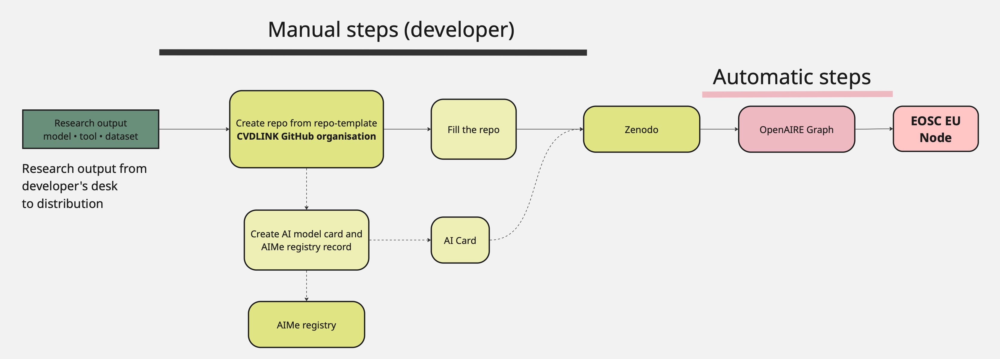

# Publishing this project

This repo was created from the CVDLINK **repo-template**. Work through the checklist below to
release it to Zenodo → OpenAIRE → EOSC. It applies to any research output — a model, a tool, or
a dataset.

If your output is an **AI model**, it also gets an AI Card and an AIMe registry entry:
➡ **[`ai-model/`](ai-model/)**. If it isn't, **delete the `ai-model/` folder** — nothing else
refers to it.

## Checklist

Everything up to the release is reversible — after the
release it is not.

### 1 · In this repo (GitHub)

- [ ] Fill in `README.md`.
- [ ] Update `CHANGELOG.md` for the release.
- [ ] Confirm the `LICENSE` (default MIT — change if needed; don't hand-write license text).
- [ ] Edit `.zenodo.json` (title, description, creators, keywords) — keep `communities: cvdlink`.
- [ ] **Validate `.zenodo.json`** (e.g. <https://www.jsonschemavalidator.net/>). If it has errors,
      Zenodo silently publishes nothing — this failure gives you no warning.
- [ ] Add the content you're sharing: code, weights, notebooks, evaluation results.

### 2 · If this project is an AI model — in this repo (GitHub)

Full detail in **[`ai-model/`](ai-model/)**. In short:

- [ ] Write the model's **model description file** (`ai-model/model-description.yaml`, copied from
      the template beside it) — one file that feeds both the AI Card and the AIMe record.
- [ ] Generate the **AI Card** and commit it — it is versioned with the model and travels into the
      Zenodo archive with the release.
- [ ] Generate and submit the **AIMe registry record**; keep the returned **report key** (you need
      it to update the entry later) and add the registry link to `README.md`.

*Not an AI model? Delete the `ai-model/` folder and skip to stage 3.*

### 3 · Make it public (GitHub)

- [ ] Make the repo **public** and confirm no sensitive content (data, site identifiers,
      credentials, internal URLs).

### 4 · Connect to Zenodo (zenodo.org) — before releasing

- [ ] Sign in to **[zenodo.org](https://zenodo.org)** with GitHub (first time only).
- [ ] On your Zenodo **GitHub settings** page, find this repo and switch the toggle **ON**.
      Press *Sync now* if a newly created repo isn't listed.

> **The next step is permanent.** A published Zenodo record cannot be deleted — it gets a DOI
> and stays. Zenodo also archives **only** releases published *after* the toggle above is on.

### 5 · Release (GitHub)

- [ ] Cut a versioned GitHub **release** — this is the distributable snapshot and the trigger for
      everything downstream.

### 6 · Verify (zenodo.org)

- [ ] Check the **Zenodo record**: metadata complete (title, authors, keywords, license), and the
      record shows in the **`cvdlink`** community.
- [ ] *(AI models)* Optionally upload the **AI Card** HTML as a file on the record too, so people
      can read it without downloading the archive.
- [ ] Add the **DOI** to `README.md` under *How to cite* — and the AI Card / AIMe links if they apply.

### 7 · Automatic — nothing to do

OpenAIRE harvests the Zenodo record, and it becomes discoverable through the EOSC EU Node.

**Later:** a new GitHub release becomes a new Zenodo version with its own DOI. Not every commit
needs one.

## Notes

- This template uses **`.zenodo.json`** for citation/metadata — it's the file Zenodo reads,
  and the only one that can carry the `cvdlink` community and EU grant info.
- The `grants` entry is pre-filled with CVDLINK's Horizon Europe grant (`101137278`) — leave it
  as-is so the record links to the project in OpenAIRE/EOSC.
- If you change the `LICENSE`, update the `.zenodo.json` `"license"` id to match (Zenodo uses
  lowercase ids, e.g. `"mit"`, `"apache-2.0"`, `"cc-by-4.0"`).
- `"upload_type"` is pre-set to `software`. **Publishing a dataset or a document instead? See
  below.**

<strong>Metadata reference</strong> — other output types, contributors, CITATION.cff, OpenAIRE minimums

- **Other `upload_type` values.** `software` (default) covers models, tools and code. Use
  `dataset` for data, or `publication` for documentation and deliverables. Full list:
  `publication`, `poster`, `presentation`, `dataset`, `image`, `video`, `software`, `lesson`,
  `physicalobject`, `other`.
  - `publication` also needs a `"publication_type"` (e.g. `report`, `deliverable`,
    `softwaredocumentation`, `article`); `image` needs an `"image_type"` (e.g. `figure`, `diagram`).
- **The `contributors` block is optional.** Fill it in for people who aren't authors (e.g. data
  curator, supervisor), or delete the whole block if there are none. Each contributor needs a
  `type` (e.g. `ProjectMember`, `DataCurator`, `Supervisor`).
- **`CITATION.cff` is optional.** Add one if you want GitHub's "Cite this repository" button.
  Zenodo ignores it when `.zenodo.json` is present, so it's purely for the GitHub UI.
- **Minimum metadata for indexing (OpenAIRE).** Every research product needs at least one
  persistent identifier — the Zenodo DOI covers this. Research software additionally needs only a
  title and a publishing date, so a correctly filled `.zenodo.json` clears the bar comfortably.

